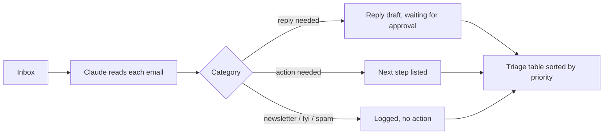

# 01 · Inbox Zero Agent

Reads every email, decides what it is, and writes reply drafts for the ones where a real person is waiting. The owner only reviews and sends.

**See it working:** [`output/triage.md`](output/triage.md) (output of the latest run)

## The problem

Business owners open dozens of emails a day just to find the few that need them.

## How it works



1. Each email goes to Claude with a clear rulebook: five categories, three priorities.
2. The answer comes back as **validated structured data** (Pydantic schema), so the code never parses free text.
3. Replies are only drafted. Nothing is sent without a person.
4. The output is a triage table sorted by priority, plus the drafts.

## Design choices

- **Human in the loop.** The agent writes, the owner approves.
- **No invented facts.** The prompt forbids confirming dates, prices or payments the agent cannot see.
- **Spam is never answered.** Phishing gets flagged, not replied to.

## Run it

```bash
pip install -r requirements.txt
export ANTHROPIC_API_KEY=your-key
python 01-inbox-zero-agent/run.py
```

The sample inbox in [`data/emails.json`](data/emails.json) is fictional. In production the same logic reads Gmail through its API.
