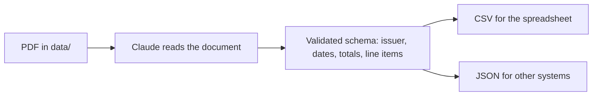

# 02 · Document Data Extraction

PDF invoices and receipts go in. Clean rows come out, ready for a bookkeeping sheet. Nobody types anything.

**See it working:** [`output/extracted.md`](output/extracted.md) · [`output/extracted.csv`](output/extracted.csv)

## The problem

Small teams still copy numbers from invoices by hand. It is slow and it is where errors start.

## How it works



1. Each PDF is sent to Claude as a document, no OCR step needed.
2. The answer must match a strict schema: type, issuer, number, dates, currency, totals, line items and a confidence flag.
3. Results are saved as CSV (for a spreadsheet) and JSON (for other tools).

## Design choices

- **Never invent values.** Missing fields stay empty instead of being guessed.
- **Confidence flag.** Low confidence documents are easy to filter for a human check.
- **One schema, many document types.** Invoices and receipts from different issuers and currencies land in the same columns.

## Run it

```bash
python 02-document-data-extraction/make_samples.py
python 02-document-data-extraction/run.py
```

The three sample documents in [`data/`](data) are fictional and are generated by [`make_samples.py`](make_samples.py).
