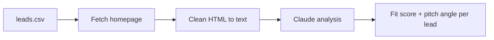

# 03 · Lead Enrichment Intelligence

Give it a list of websites. It reads each homepage live and returns what the business does, who it sells to, where it probably still works by hand, a fit score and a personal opening line.

**See it working:** [`output/enriched.md`](output/enriched.md)

## The problem

Good outreach needs research, and research takes 10 to 20 minutes per lead. So most people skip it.

## How it works



1. Each website is downloaded and cleaned (scripts, styles and menus removed).
2. Claude analyses only that text and returns a validated schema.
3. Leads are ranked by fit score, with the manual work signals and a pitch angle tied to something real on the page.

## Design choices

- **Grounded in the page.** If the text is too thin, the score is 0 instead of a guess.
- **A hook, not a full email.** The person still writes the message; the agent finds the angle.
- **Fails gently.** A site that does not load is reported and skipped, the rest of the list still runs.

## Run it

```bash
python 03-lead-enrichment/run.py
```

Edit [`data/leads.csv`](data/leads.csv) to try your own list. The sample uses public homepages of well-known software companies.
