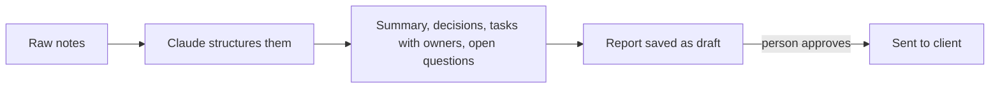

# 04 · Autonomous Report Builder

Messy meeting notes in. A clear client report out, with decisions, next steps and open questions, waiting for one human approval before it goes anywhere.

**See it working:** [`output/pending-approval/`](output/pending-approval)

## The problem

After every client call, someone has to turn rough notes into a proper recap. It happens late or not at all, and next steps get lost.

## How it works



1. Notes are written however the consultant writes them: abbreviations, typos, half sentences.
2. Claude returns a validated structure: summary, what we heard, decisions, action items with owner and due date, open questions, next meeting.
3. The report is rendered and saved in `pending-approval/`. In production the approval step is one click (email link or status change) before the client receives it.

## Design choices

- **Nothing reaches the client without a person.**
- **Open stays open.** Anything undecided in the notes goes to open questions, never turned into a decision.
- **Data first, document second.** Action items exist as data, so they can also go straight into a task tool.

## Run it

```bash
python 04-report-builder/run.py
```

The notes in [`data/notes/`](data/notes) are fictional.
