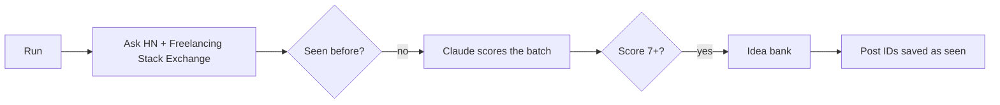

# 05 · Content Idea Generator

Each run reads the questions founders and freelancers asked recently in public communities, finds the real problem behind each one, and keeps only the ideas worth making, with an angle, a hook and a format.

**See it working:** [`output/latest.md`](output/latest.md) (real posts from the latest run)

## The problem

Content calendars are filled by guessing. The questions an audience really has are already public, but nobody has time to read them all.

## How it works



1. Pulls the week's Ask HN threads and the month's top questions on Freelancing Stack Exchange, through their public APIs (no key needed).
2. Skips anything already processed, using `output/seen.json` as memory.
3. Sends the whole batch to Claude in **one request** and gets back a score, pain point, angle, hook and format per post.
4. Keeps only ideas scoring 7 or more, with a link to the original discussion.

## Design choices

- **Real questions over trends.** Ideas come from people describing their own problems.
- **Memory before cost.** Deduplication runs before the AI call, so the same post is never paid for twice.
- **Threshold, not volume.** A short list of strong ideas beats a long list of noise.

## Run it

```bash
python 05-content-idea-generator/run.py
```

Add a source by writing one more small function that returns posts in the same shape, and change the audience line in the prompt to fit another brand.
