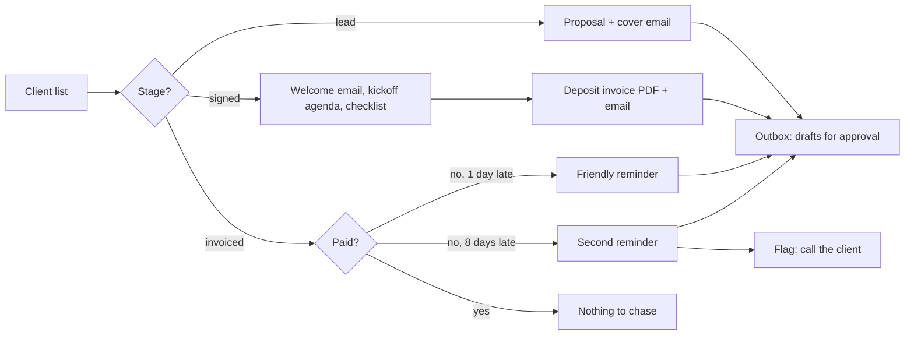

# 06 · Client Lifecycle Engine

From meeting notes to paid invoice. One client list goes in, and every run does the next step for each client: proposal, onboarding, deposit invoice and a payment reminder if a week goes by without payment.

**See it working:** [`output/pipeline.md`](output/pipeline.md) · email drafts in [`output/outbox/`](output/outbox)

## The problem

Between "yes, let's do it" and the first payment there are a dozen small admin tasks: write the proposal, send the welcome email, list who does what, send the invoice, remember to chase it. They are easy to forget and they eat the hours before any billable work starts.

## How it works



1. Reads [`data/clients.json`](data/clients.json): who the client is, the price, and three dates (first call, signed, paid) that a CRM or e-signature tool would normally fill in.
2. **Lead:** Claude turns the meeting notes into a proposal and a cover email. The investment section is added by code.
3. **Signed:** Claude writes the welcome email, the kickoff agenda and the project checklist. Code creates the deposit invoice (50%, due in 7 days) as a PDF, dated the day it is created.
4. **Invoiced and unpaid:** the day after the due date (a week after the invoice) Claude drafts a light reminder, a week later a clearer one, and then the board says to call.
5. Writes a pipeline board with every client's stage and next step.

## Design choices

- **Code owns the numbers.** Prices, deposits, due dates and invoice numbers are calculated in Python. Claude only writes the words, so it can never get an amount wrong.
- **Memory between runs.** `output/state.json` remembers what was already done, so a proposal or a reminder is never created twice.
- **Nothing is sent.** Every email is a draft in `outbox/` until a person approves it.
- **The proposal says what, never how.** It describes the result for the client, not a recipe they could follow alone.
- **Reminders escalate kindly.** Two emails, then a human call, never an endless chase.

## Run it

```bash
python 06-client-lifecycle/run.py
TODAY=2026-11-27 python 06-client-lifecycle/run.py   # pretend it is another day
```

The sample output comes from four runs on 2026-11-05, 11-13, 11-20 and 11-23, so every stage is visible. The clients are fictional. Bloom Bakery and Maia Yoga reuse the meeting notes from [04 · Report Builder](../04-report-builder), so the two automations connect: the report goes to the client, and the proposal comes next.
