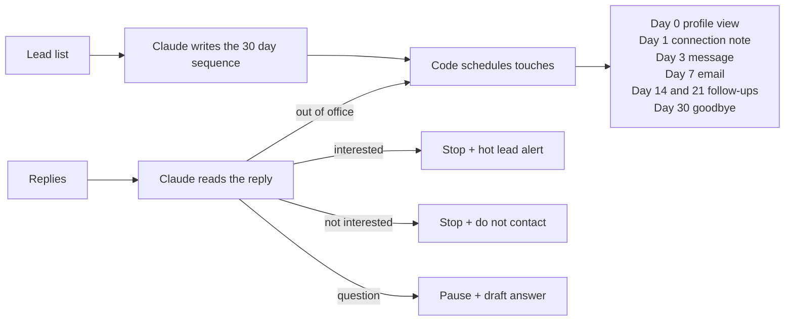

# 07 · LinkedIn Outreach Engine

A 30 day, multi-touch campaign written for each lead from her own words. It stops itself on a no, pauses on a question, and alerts you on a yes.

**See it working:** [`output/campaign.md`](output/campaign.md) · [`output/alerts.md`](output/alerts.md) · one timeline per lead in [`output/leads/`](output/leads)

## The problem

Good outreach takes many touches, and each one should say something real. Done by hand, people either give up after one message or send the same template to everyone. The worst case is still following up with someone who already said no.

## How it works



1. For each lead in [`data/leads.json`](data/leads.json), Claude writes the whole sequence in **one request**, grounded in her latest post and business.
2. Code walks the calendar day by day and decides what is due, on which channel.
3. Every reply is read by Claude and sorted into interested, not interested, question or out of office.
4. The run writes a campaign board, a timeline per lead, hot lead alerts and a do-not-contact list.

## Design choices

- **Every touch adds something.** An idea, a small example or a question. Never "just checking in".
- **Channel rules in code.** No LinkedIn message before the connection is accepted. If she never accepts, LinkedIn touches move to email.
- **A no is final.** Not interested goes to `do-not-contact.json` and the sequence stops that same day.
- **Humans take over when it matters.** A yes or a question stops the automation, and the answer is a draft for approval.
- **Nothing is sent or clicked.** Automating LinkedIn breaks its rules, so the engine produces a daily task queue and drafts that a person or an approved tool executes.
- **One AI call per lead, one per reply.** The sequence is stored in `state.json`, so later runs cost nothing.

## Run it

```bash
python 07-linkedin-outreach/run.py
TODAY=2026-11-26 python 07-linkedin-outreach/run.py   # see what is due on another day
```

The five leads and their replies are fictional. In a real setup they come from a lead list (Apollo, a CSV or a CRM) and the replies from LinkedIn and the inbox.
